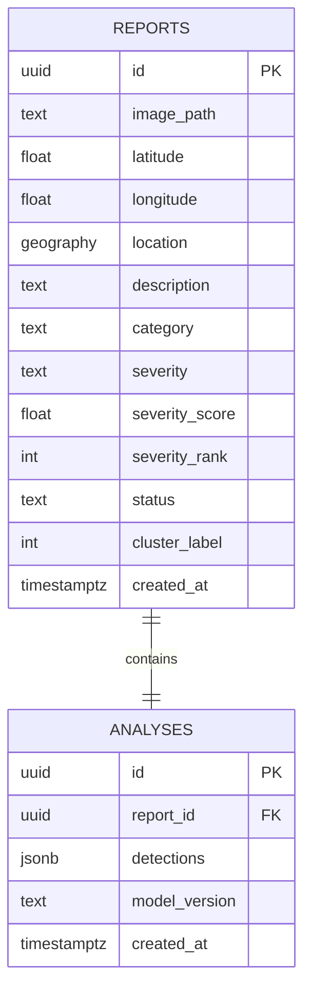

# RoadWatch Database Design

## ER model



The `reports.location` value is generated from (longitude, latitude), not written separately, preventing coordinate inconsistency. WGS84 is used (SRID 4326). The GiST index supports geographic radius queries. The priority index supports sorting in High → Medium → Low → None order, newest first.

## Data flow

```text
Flutter photo + GPS → FastAPI /analyze → Supabase Storage pending/
                → YOLO + severity → preliminary result
Submit confirmation → FastAPI /reports → Storage reports/
                → insert_report() → reports + analyses (one SQL transaction)
                → DBSCAN module → bulk_update_clusters()
Staff Dashboard → FastAPI GET /reports → severity sorted records
Staff status PATCH → FastAPI auth → update_status()
```

## Storage

Bucket: `road-images` (private). Suggested object keys: `pending/<generated-id>.jpg` for unconfirmed uploads and `reports/<generated-id>.jpg` for confirmed reports. Store only the object key in the database. M2 handles uploads/moves; M3 provides bucket configuration and 24-hour pending cleanup.

## Clustering

Member 5 owns DBSCAN + Haversine parameter tuning. Member 3 only provides geographic persistence and cluster label write-back. Since recomputing DBSCAN can reassign labels, dashboard badges must not treat integer `cluster_label` as a stable identifier across runs.

## Privacy and access

The `reports` and `analyses` tables have RLS enabled and access for browser-facing `anon` and `authenticated` roles revoked. The backend uses a server-side PostgreSQL connection. The private bucket requires authorized access to images. Photos for demonstrations should blur faces and license plates.

## SQL migration strategy

Migrations live in `infra/db/migrations/`. Each is recorded with SHA-256 in `schema_migrations`. Do not edit a migration that has already been applied. Add another numbered migration instead.
