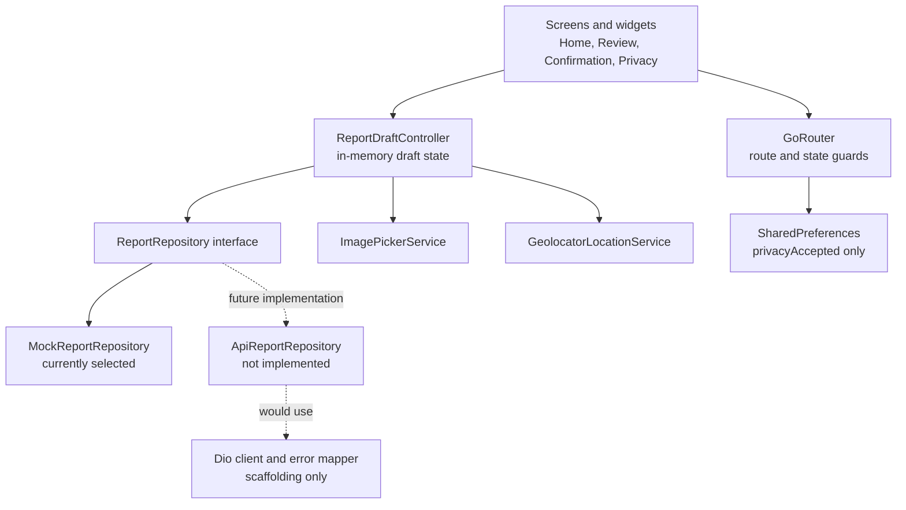
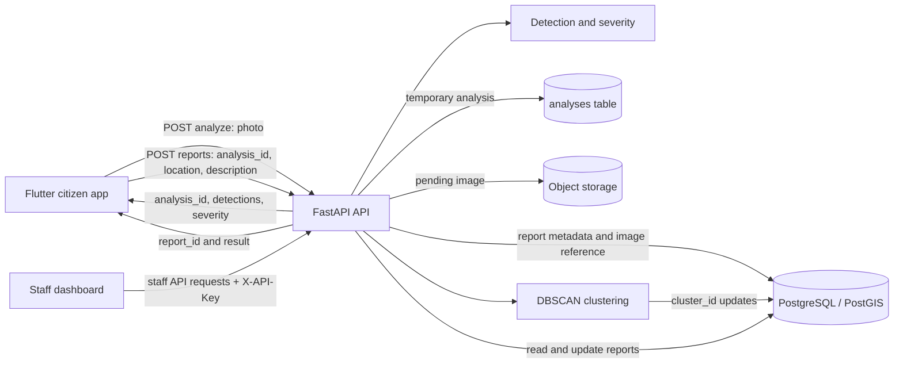

# RoadWatch Mobile Architecture

## 1. Overview

RoadWatch Mobile is a Flutter/Dart citizen app for preparing and submitting road-damage reports. The current implementation has a usable report-capture and review flow, device location support, privacy acknowledgement, and a mock report repository. It does **not** yet communicate with a real backend: selecting the real-backend configuration currently throws `UnimplementedError`.

This distinction matters when planning integration:

| Status | Meaning in this document |
| --- | --- |
| **Implemented** | Present in the mobile source and used by the app. |
| **Mocked** | Deliberately simulated; results are not persisted by the service. |
| **Incomplete** | Some supporting code or UI exists, but the end-to-end feature is not connected. |
| **Missing** | No implementation was found in the mobile app or the relevant project component. |
| **Inferred / proposed** | Required or implied by project decisions and planning documents, but not a finalized implementation contract. |

The mobile app is one client in a system where the backend is intended to own validation, AI inference, severity scoring, image storage, and persistence. The mobile app should send a photo and report metadata, display the backend's preliminary result, and never calculate or submit authoritative predictions.

The source of truth for shared names and values is [`../../docs/architecture/vocabulary.md`](../../docs/architecture/vocabulary.md). The API contract is not yet defined: [`../../docs/api/README.md`](../../docs/api/README.md) is a placeholder, and the planned `contract.md` and exported OpenAPI document are absent. The initial database design is in [`../../docs/project_description.md`](../../docs/project_description.md), but it is a proposal rather than a finalized migration.

## 2. Technology Stack

| Technology | Use |
| --- | --- |
| Flutter / Dart | Cross-platform UI framework and application language. The project is currently configured and demonstrated for Android. |
| `material_ui` | Material-style widgets and UI primitives used by screens and theme. |
| Riverpod (`flutter_riverpod`) | Dependency injection and the report-draft state controller. |
| `go_router` | Named-path navigation and route guards. |
| Dio | Shared HTTP-client setup and timeout/error-mapping scaffolding. No real report API repository currently uses it. |
| `image_picker` | Opens the device camera or gallery and returns a selected image. |
| `geolocator` | Checks location services and permission, obtains coordinates, and opens device/app settings. |
| `shared_preferences` | Persists whether the privacy notice was acknowledged. It is not report storage. |
| `uuid` | Declared as a dependency; no use was found in the inspected Dart source. |
| Android / Kotlin | Native Android host activity and Gradle wrapper/configuration for the Flutter app. Business behavior is in Dart. |

The Dart SDK constraint is `^3.13.4` in [`pubspec.yaml`](pubspec.yaml). The app uses locally declared `PlusJakartaSans` and `Inter` fonts in the same manifest. Lint configuration is in [`analysis_options.yaml`](analysis_options.yaml).

## 3. Project Structure

The relevant application source is organized by shared app infrastructure and feature-specific code:

```text
apps/mobile/
├── lib/
│   ├── main.dart                         # Flutter entry point; preference initialization
│   ├── providers.dart                    # Shared dependency providers
│   ├── app/
│   │   ├── app.dart                      # MaterialApp.router root
│   │   ├── config.dart                   # Compile-time API/environment settings
│   │   ├── router.dart                   # Routes and privacy/report-draft guards
│   │   └── theme.dart                    # Theme, colors, typography, widgets
│   ├── core/
│   │   ├── errors/                       # AppException types and user-facing messages
│   │   ├── network/                      # Dio client and Dio error mapper
│   │   ├── services/                     # Image picking and location abstractions
│   │   ├── storage/                      # SharedPreferences provider/key
│   │   └── widgets/                      # Shared AI disclaimer
│   └── features/
│       ├── onboarding/
│       │   └── privacy_screen.dart
│       └── report/
│           ├── domain/                   # Report models and repository interface
│           ├── data/                     # MockReportRepository
│           └── presentation/             # Screens, draft controller, UI widgets
├── android/                              # Native Android project and permissions
└── test/widget_test.dart                 # Current starter counter test
```

Responsibilities and useful implementation references:

- Startup and dependency wiring: [`lib/main.dart`](lib/main.dart), [`lib/providers.dart`](lib/providers.dart).
- Root widget, navigation, configuration and theme: [`lib/app/app.dart`](lib/app/app.dart), [`lib/app/router.dart`](lib/app/router.dart), [`lib/app/config.dart`](lib/app/config.dart), [`lib/app/theme.dart`](lib/app/theme.dart).
- Report state and business flow: [`lib/features/report/presentation/report_draft_controller.dart`](lib/features/report/presentation/report_draft_controller.dart).
- Report types and the repository boundary: [`lib/features/report/domain/report_models.dart`](lib/features/report/domain/report_models.dart), [`lib/features/report/domain/report_repository.dart`](lib/features/report/domain/report_repository.dart).
- Current mock implementation: [`lib/features/report/data/mock_report_repository.dart`](lib/features/report/data/mock_report_repository.dart).
- Location and image adapter interfaces/implementations: [`lib/core/services/location_service.dart`](lib/core/services/location_service.dart), [`lib/core/services/geolocator_location_service.dart`](lib/core/services/geolocator_location_service.dart), [`lib/core/services/image_source_service.dart`](lib/core/services/image_source_service.dart), [`lib/core/services/image_picker_service.dart`](lib/core/services/image_picker_service.dart).
- Android permissions and native activity: [`android/app/src/main/AndroidManifest.xml`](android/app/src/main/AndroidManifest.xml), [`android/app/src/main/kotlin/com/roadwatch/roadwatch_mobile/MainActivity.kt`](android/app/src/main/kotlin/com/roadwatch/roadwatch_mobile/MainActivity.kt).

Generated `build/`, `.dart_tool/`, and Android Gradle files are not application architecture and should not be treated as source-of-truth implementation.

## 4. Architecture and Internal Communication

The app follows a small layered structure rather than a large formal Clean Architecture setup:

1. **Presentation:** Flutter screens render state and call controller methods.
2. **State / application flow:** `ReportDraftController` owns the current in-memory report draft, coordinates services, and handles analysis/submission loading and errors.
3. **Domain:** `ReportRepository` and report/location types define boundaries without tying the UI to Dio or a particular backend.
4. **Adapters / infrastructure:** image-picker and geolocation implementations access device plugins; the mock repository simulates the backend. A Dio client exists, but no production repository is connected.



**State management:** `reportDraftProvider` is a Riverpod `NotifierProvider`. Its `ReportDraftState` keeps the selected `File`, location result, analysis result, notes, and submission result in memory. Loading and errors use Riverpod `AsyncValue`. The draft is not backed by a database or local report cache and will not survive process termination.

**Navigation:** `GoRouter` declares `/privacy`, `/`, `/review`, and `/confirmation`. The router redirects first-time users to privacy until `privacy_accepted` is stored. It also blocks the review route if there is no image, and blocks confirmation unless submission completed successfully. The report flow uses `push` to show review and `go` to move to confirmation/home.

**Device services:** `ImageSourceService` and `LocationService` keep Flutter plugins out of the report controller's core logic. The location abstraction has explicit results for found, disabled, permission denied, permission permanently blocked, and unavailable states. A mock location service exists but the default provider selects real geolocation.

## 5. Application Startup and User Workflows

### Startup

1. Flutter invokes `main()` in [`lib/main.dart`](lib/main.dart).
2. `WidgetsFlutterBinding.ensureInitialized()` prepares plugin access.
3. The app obtains `SharedPreferences`.
4. `ProviderScope` overrides `sharedPreferencesProvider` with the initialized preferences.
5. `RoadWatchApp` builds `MaterialApp.router`, applying the theme and router.
6. The router checks the persisted privacy flag and sends a first-time user to the privacy notice before the home screen.

### Citizen report flow

1. **Home:** [`HomeScreen`](lib/features/report/presentation/home_screen.dart) presents camera and gallery choices and explains the reporting process.
2. **Choose photo:** `ImagePickerService` asks `image_picker` for a camera/gallery image. It requests a maximum dimension of 1280 pixels and image quality 85, then returns a local `File`. These are client-side size-reduction settings, not a server-enforced type/size guarantee.
3. **Start draft:** `ReportDraftController.pickPhoto()` creates fresh draft state, retaining existing notes and location, then starts location retrieval and repository analysis concurrently. Navigation to review happens as soon as the image is chosen; the review screen shows loading while analysis finishes.
4. **Review:** [`ReviewScreen`](lib/features/report/presentation/review_screen.dart) shows the photo, AI result, preliminary severity, GPS coordinates/status, optional notes, and submission button. Analysis failure offers retry or another gallery photo. Location failure offers applicable retry/settings actions.
5. **No detections:** An empty detection list displays a no-damage message and retake control. The ordinary submit button remains available when analysis and location are ready, so submission is possible, but the UI does not currently have a distinct button labeled “Submit anyway.”
6. **Submit:** `submit()` trims notes and sends a `ReportSubmission` through the repository. While pending it disables duplicate submission and displays progress.
7. **Confirmation:** On success, the controller result causes navigation to [`ConfirmationScreen`](lib/features/report/presentation/confirmation_screen.dart), which displays the report ID and any returned severity. “Report another problem” resets the in-memory draft.

### Implemented versus incomplete functionality

| Feature | Current status |
| --- | --- |
| Privacy notice and remember-acceptance flag | **Implemented**, with a single boolean stored locally. |
| Camera/gallery selection and image resizing | **Implemented** through `image_picker`; no explicit client validation of MIME type or final byte size was found. |
| Real GPS location, permission states and settings links | **Implemented** through `geolocator`; location is required by `canSubmit`. Android declares fine/coarse location permissions in the manifest. |
| Analysis and submission screens/states | **Implemented as UI/state flow**, but data comes from a mock repository by default. |
| Backend inference and report persistence | **Missing from mobile integration.** No API repository or request calls exist. |
| Mock network scenarios | **Mocked** in `MockReportRepository`: success, no detections, timeout, no connection, bad image, and server error. The default provider chooses success and waits 1.5 seconds. |
| Citizen account/login | **Not implemented / not required** by the MVP decision; citizen submissions are anonymous. |
| “My reports” / report-status history | **Not implemented and explicitly cut from the MVP** by [`../../docs/decisions/README.md`](../../docs/decisions/README.md). |
| Report persistence/offline queue | **Missing.** Only privacy acknowledgement is persisted locally. |
| Automated feature tests | **Incomplete.** `test/widget_test.dart` is still the generated counter smoke test and does not exercise RoadWatch flows. |

## 6. Data Models and Data Flow

### Mobile-side types

The report types are in [`lib/features/report/domain/report_models.dart`](lib/features/report/domain/report_models.dart):

| Type | Fields / purpose |
| --- | --- |
| `Severity` | Enum `none`, `low`, `medium`, `high`. The UI renders these as `None`, `Low`, `Medium`, `High`, marked “preliminary.” |
| `Detection` | `category` string and `confidence` double. It does not contain a bounding box or a formal API class field. |
| `AnalysisResult` | List of detections plus severity; `hasDetections` is derived from whether the list is nonempty. |
| `ReportSubmission` | Local `File image`, `latitude`, `longitude`, and nullable `notes`. |
| `SubmittedReport` | `reportId` string and nullable severity. |

`ReportDraftState` adds transient state: image, picker failure, location lookup status/result, analysis `AsyncValue`, current notes, and submission `AsyncValue`. Coordinates are represented by `Coordinates` in `location_service.dart`; these are decimal-degree latitude and longitude values.

### Transformation and validation

- The picker may resize/recompress the chosen photo. There is no separate image format/byte-size validation in the app source; the backend must remain authoritative.
- The controller trims notes and converts an empty string to `null` at submit time.
- Location is represented as named latitude/longitude values. No manual range check is present in the mobile client; the API must validate `latitude ∈ [-90, 90]` and `longitude ∈ [-180, 180]`.
- The app displays confidence as a percentage by multiplying the returned `double` by 100. It does not calculate severity.
- Analysis and report submission failures are converted to `AppException` types and rendered as user-facing messages. The current Dio mapper classifies some HTTP statuses, but is unused because no API repository is wired.

### Local and remote data

- **Local persistent data:** `privacy_accepted` in `SharedPreferences` (`lib/core/storage/preferences.dart`).
- **Local transient data:** report draft, selected image path, analysis and submission state in Riverpod memory. The image file is not copied into a durable app-owned report store.
- **Remote data expected:** analysis metadata and temporary image during the preview/submit interval; final report metadata and image object after submission. Database rows should contain an object-storage reference, not image bytes.

```mermaid
flowchart LR
  User["Citizen"] --> Pick["Camera / gallery"]
  Pick --> File["Local resized image File"]
  File --> Draft["ReportDraftController"]
  Draft -->|parallel| Location["LocationService"]
  Draft -->|analyze(File)| Repository["ReportRepository"]
  Repository --> Mock["Mock result today"]
  Repository -. future .-> API["POST analyze"]
  Location --> Draft
  Draft --> Review["Review screen"]
  Review -->|submit metadata| Repository
  Repository --> Confirmation["Confirmation with report ID"]
```

## 7. Backend Integration Expectations

### Current client integration code

- [`lib/app/config.dart`](lib/app/config.dart) defines a base URL and API prefix.
- [`lib/core/network/dio_client.dart`](lib/core/network/dio_client.dart) creates a Dio client with JSON `Accept` header and configurable connection/send/receive timeouts. Debug logging omits request/response bodies.
- [`lib/core/network/dio_error_mapper.dart`](lib/core/network/dio_error_mapper.dart) maps Dio failures into app exceptions.
- [`lib/features/report/domain/report_repository.dart`](lib/features/report/domain/report_repository.dart) defines `analyze(File)` and `submit(ReportSubmission)`.
- [`lib/providers.dart`](lib/providers.dart) selects the mock repository by default. With `USE_MOCK=false`, it currently throws `UnimplementedError('Real repository pending the API contract')`.

There are no real endpoint calls, multipart upload code, JSON encoders/decoders, or API response parsers in the mobile source.

### Intended endpoints and request responsibilities

The project has decided on the two-step, server-side analysis cache flow (DEC-03 and DEC-04 in [`../../docs/decisions/README.md`](../../docs/decisions/README.md)). Endpoint details below are **integration expectations**, not a finalized OpenAPI contract.

| Endpoint | Intended mobile use | Expected responsibility |
| --- | --- | --- |
| `POST /api/v1/analyze` | Public; upload the chosen image, likely as multipart form data. | Validate image; run backend detection/severity; return the detections, severity values, and `analysis_id` used in the next step. |
| `POST /api/v1/reports` | Public; send report metadata referencing the prior analysis. | Reuse the stored analysis; persist report and final image reference; cluster; return a report ID and submission result. |
| `GET /api/v1/health` | Public deployment/test endpoint; not currently used by the app. | Backend health information. |
| Staff report listing/detail/status endpoints | Not a citizen-app responsibility. | Require the dashboard's shared `X-API-Key`; do not embed this staff key in the mobile app. |

The vocabulary describes `analysis_id` and `report_id` as UUIDs, `severity_label` and `severity_score` as the shared severity fields, and a detection as `class_name`, `confidence`, and `bbox`. Final multipart field names, exact JSON response bodies, HTTP status/error shapes, image constraints, and description limit still need to be recorded in the API contract before client implementation.



This is the **intended** system flow from project decisions, not a deployed integration. The database, backend, and API contract are not present as implementations in this repository.

### Important mobile/backend contract mismatches

1. **Two-step identifier is absent from mobile models.** The chosen flow requires `analysis_id` from analysis to be sent during report submission. `AnalysisResult` has no ID, while `ReportSubmission` contains the image again and has no analysis ID. The current interface therefore cannot implement the agreed flow as written.
2. **The mobile submit model conflicts with the decision.** DEC-03/04 says the server caches analysis and `/reports` reuses it. The mobile model has an image field at submission time. The API adapter should upload the image during analysis and submit only the analysis reference plus location/description, unless owners explicitly revise the decision.
3. **The mobile field is `notes`; shared API vocabulary is `description`.** Keep the UI wording if desired, but map to the agreed API key and enforce the backend's configured maximum length. The screen currently has no `maxLength`.
4. **Detection values differ.** Mock categories are display labels such as `Longitudinal crack` and `Pothole`; the shared vocabulary uses lowercase snake_case API strings such as `longitudinal_crack` and `pothole` (the final category list is still provisional). Add a mapping or decode agreed API identifiers before display.
5. **Detection shape is incomplete.** The API vocabulary includes bounding boxes; the mobile `Detection` type has only category and confidence. The screen may not need boxes, but the decoder should safely accept the full API shape or the contract must define a smaller mobile response.
6. **Severity data is incomplete.** Mobile stores a label only. Shared vocabulary defines both `severity_label` and numeric `severity_score`, with `None` score `0.0`; whether the mobile needs to retain or display the score should be settled as part of response modeling.
7. **Error mapping is too coarse for the proposed API errors.** The Dio mapper currently treats all `400`, `413`, `415`, and `422` responses as invalid-image errors. This can misreport coordinate, description, or other validation failures. It does not decode the shared error `code` values.
8. **Vocabulary wording should be reconciled.** The app's current no-detection and location messages are not exactly the fixed shared texts in `vocabulary.md`. Align them when integrating, preserving the required “preliminary” AI disclaimer and blocking submission without GPS.
9. **The submission response is not finalized.** The illustrative response in `project_description.md` uses `severity`, while the shared vocabulary says `severity_label` and `severity_score`. Follow the vocabulary and finalize the contract rather than coding to the illustrative example.

### Authentication and transport

The intended citizen API is public and anonymous; the mobile app has no login or token handling. Staff authorization applies to dashboard endpoints and uses `X-API-Key` according to DEC-06, not to citizen report creation. Do not ship a shared staff key in the app.

The app uses compile-time Dart defines, not a `.env` file:

| Define | Default | Effect |
| --- | --- | --- |
| `API_BASE_URL` | `http://10.0.2.2:8000` | API host/scheme; `10.0.2.2` reaches the host machine from the Android emulator. A physical phone needs a reachable development host. |
| `API_VERSION_PATH` | `/api/v1` | Prefix appended to the base URL. |
| `USE_MOCK` | `true` | Selects the mock repository. Setting false currently fails at provider construction because the real repository is absent. |
| `AUTHORITY_NAME` | `Municipal Services` | Display name in the home screen. |

The configured timeouts are 35 seconds to connect, 35 seconds to send, and 65 seconds to receive. They reflect expected cold-start and inference latency but need verification against the selected host. Use HTTPS in deployed environments. Native Android traffic is not normally subject to browser CORS restrictions; CORS still matters for browser-based clients such as the dashboard.

## 8. Database Requirements

There is no finalized database schema or migration in the repository. The following describes the project requirements and planning proposal; it is **not** evidence that the tables are implemented.

### Remote entities and relationships

- **`reports`** — one durable row per submitted citizen report. The initial proposal in `project_description.md` includes a UUID identifier, timestamps, PostGIS location, optional description, nullable primary damage category, confidence, full detections JSON, severity label/score, status, nullable cluster ID, and an image-storage reference.
- **`analyses`** — temporary server-side state required by DEC-03/04 to bridge `/analyze` and `/reports`: analysis UUID, temporary image path, detections JSON, severity label/score, and creation timestamp. Pending image objects and analysis rows older than 24 hours are to be cleaned up.
- **Image object storage** — original/processed report image objects live outside PostgreSQL. The database stores only the path or URL reference. Proposed prefixes in `vocabulary.md` are `pending/<analysis_id>.<ext>` and `reports/<report_id>.<ext>`.
- **Spatial point** — the initial proposal uses `geography(Point, 4326)`. API coordinates are named `latitude` and `longitude`; when constructing a PostGIS point, coordinate order is longitude then latitude.

The following captures the fields in the initial report proposal and shared vocabulary. It is an integration checklist, not a finalized DDL:

| Entity | Expected fields |
| --- | --- |
| `reports` | UUID ID (`id` in the initial schema; `report_id` in the API vocabulary—reconcile these names), `created_at`, `updated_at`, storage path/URL, `location`, nullable `description`, nullable `damage_category`, `confidence`, `detections` JSON, `severity_label`, `severity_score`, `status`, nullable `cluster_id`. |
| `analyses` | UUID `analysis_id`, temporary image path, `detections` JSON, `severity_label`, `severity_score`, `created_at`; delete the row and pending object after expiry (24 hours). |
| Detection JSON item | `class_name`, `confidence` in `[0, 1]`, and `bbox` as `[x_min, y_min, x_max, y_max]` in pixels relative to the original image, per the shared vocabulary. |

`analyses` logically precedes report creation, but the final schema has not established whether `reports` stores an `analysis_id` foreign key, whether the analysis row is deleted after consumption, or whether the analysis ID is retained for audit. Decide and document those lifecycle details in the finalized schema. Keep report creation atomic from the client's perspective: no success response for a partially persisted report.

### Required operations and data ownership

| Operation | Owner / requirement |
| --- | --- |
| Create temporary analysis and upload pending image | Backend after validating `/analyze` input. |
| Read analysis by `analysis_id` | Backend during `/reports`; reject unknown or expired IDs. |
| Create report and move/store final image | Backend; persist metadata and storage reference. |
| Read reports / details | Backend for staff dashboard, not currently required by the mobile MVP. |
| Update report status | Staff backend endpoint; validate allowed transition. |
| Update nullable `cluster_id` | Backend clustering flow; clusters suggest duplicates and do not merge/delete reports. |
| Delete expired temporary analyses and pending images | Cleanup job/script after the 24-hour window. |

The mobile app should not connect directly to PostgreSQL or Supabase tables. It sends HTTP requests to the backend; the backend coordinates SQL/PostGIS and object storage. No local report-history database is needed for the current MVP. `reporter_ref`, a `staff_users` table, and “my reports” are out of MVP scope per the decision log and weekly task notes, despite appearing in older initial proposals.

## 9. Integration Gaps and Dependencies

### Current repository state

- **Mobile:** screen/state/service abstractions and mock implementation exist; the real HTTP repository is missing.
- **Backend:** [`../../services/api/README.md`](../../services/api/README.md) describes a planned FastAPI service, but the component contains no API implementation.
- **Contract:** [`../../docs/api/README.md`](../../docs/api/README.md) asks for agreed schemas; no `contract.md` or OpenAPI export is present.
- **Database/infrastructure:** [`../../infra/README.md`](../../infra/README.md) contains guidance only. No `infra/db/migrations` files or finalized database schema are present.
- **ML:** the project describes backend-owned YOLO detection and severity. The mobile app contains no inference model and must not become the prediction authority.

### Dependencies to resolve before end-to-end connection

1. Finalize API request/response and error schemas, including multipart upload details, analysis identifier, report submission payload, validation limits, status codes, and field names.
2. Finalize the database schema and storage lifecycle for analyses, reports, image paths, and cleanup.
3. Confirm the final damage category list and backend response shape with the ML and API owners.
4. Implement the API service, model/severity pipeline, storage adapter, database migrations, and cleanup process before a real client flow can be validated.
5. Implement a mobile `ApiReportRepository`, wire it through providers, and update the mobile model/interface to carry the server-issued analysis ID.
6. Verify backend host, cold-start behavior, upload size, inference latency, and timeouts on emulator and physical Android devices.

## 10. Recommended Integration Steps

1. **Publish the contract first.** Define `POST /api/v1/analyze` as an image upload and specify a response that includes `analysis_id`, detections, and `severity_label`/`severity_score`. Define `POST /api/v1/reports` to accept `analysis_id`, `latitude`, `longitude`, and nullable `description`; explicitly do not accept client-computed predictions.
2. **Align shared naming.** Confirm the final category identifiers, detection object, no-detection behavior, error body/codes, description limit, image constraints, UUID format, and report ID response. Resolve the illustrative `severity` versus vocabulary `severity_label` mismatch in the contract.
3. **Finalize data/storage lifecycle.** Create migration(s) for reports and temporary analyses, spatial/query indexes, object-storage paths, transactional report creation, and the 24-hour pending cleanup. Decide how analysis rows relate to completed reports.
4. **Complete the mobile repository boundary.** Add a real repository using the existing Dio provider; upload the image during analysis; decode the response; retain the returned analysis ID; submit that ID with coordinates and description; decode the report ID. Change models/interfaces as needed so a real submission does not re-upload/re-analyze the image contrary to DEC-03.
5. **Make errors precise.** Parse backend error codes into user-meaningful exceptions rather than mapping every validation status to “invalid image.” Keep timeout, offline, invalid-image, invalid-coordinate, too-long-description, expired-analysis, unauthorized, and server-failure cases distinguishable where they apply.
6. **Check client/server validation together.** Keep client resizing as a usability optimization only. Backend must enforce actual MIME/size constraints, description length, coordinate ranges, expired/unknown analysis IDs, and all-or-nothing persistence.
7. **Configure environments safely.** Set `API_BASE_URL` for emulator, physical-device testing, and deployment; retain the `/api/v1` prefix; require HTTPS for deployed API calls. Do not set `USE_MOCK=false` until the real repository is implemented, because it currently raises `UnimplementedError`.
8. **Exercise key end-to-end cases.** Test successful detection and submission, no detections followed by submit, retake, GPS disabled/denied/permanently denied, analysis expiration, rejected image, invalid server responses, offline/timeout, and duplicate-tap prevention. Replace or supplement the starter counter widget test with tests for these mobile behaviors.

Once these pieces are in place, the intended ownership boundary is simple: the mobile app captures user input and presents results; FastAPI is the sole public integration point; PostgreSQL/PostGIS stores report metadata and geospatial state; object storage holds images; and backend ML/clustering services produce the authoritative analysis and duplicate-group data.
